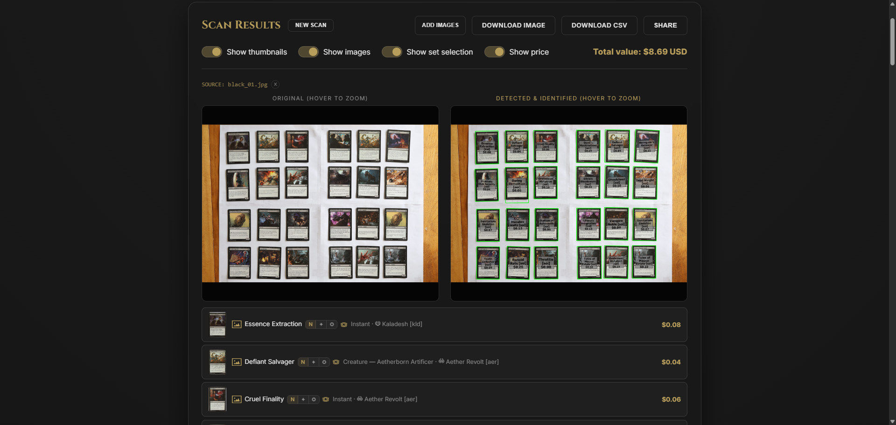
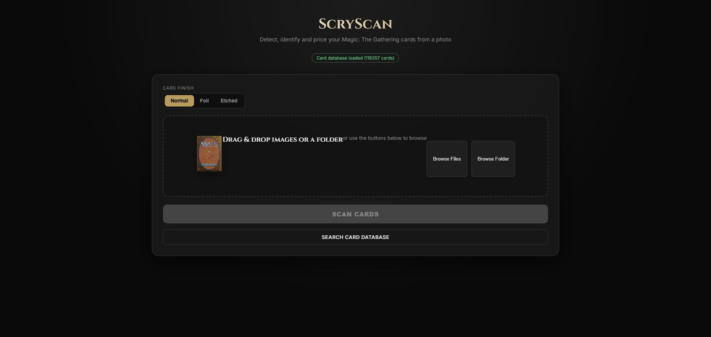
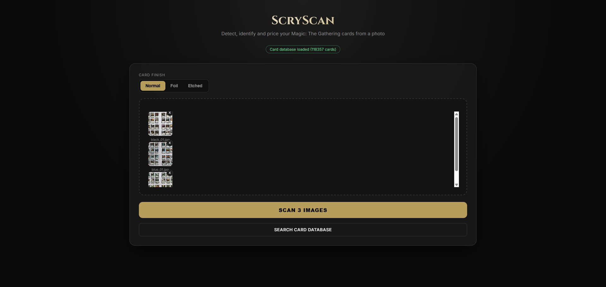
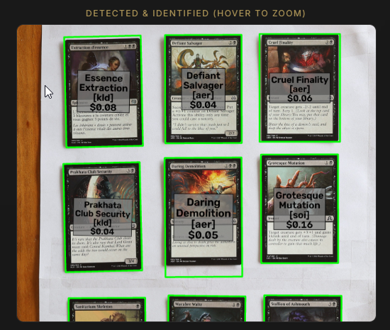
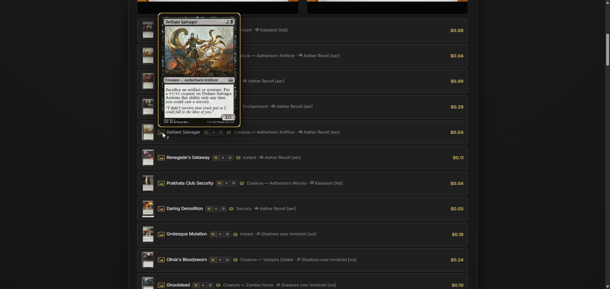

<p align="center">
  
</p>

> **⚠️ Disclaimer: 100% vibe-coded.** This project is 100% vibe-coded —
> AI-generated code steered by its author. It is provided "as is", without
> warranty of any kind, and the author cannot be held responsible for any issue
> or harm arising from its use.

Detect Magic: The Gathering cards in a photo, identify them against a local
Scryfall database (perceptual hashing), correct each card's perspective to an
upright 5:7 crop, and export the results (name, set, price, foil flag) — via a
Flask web UI or the command line. Cards whose artwork is printed in several
sets (reprints, promos, symbol-set reissues) are additionally disambiguated by
their set symbol, and the set can be picked manually in the web UI.

The repository ships only code and a few small assets. Everything large (the
card database, the card-image cache) is **generated** — section 2 explains how
to build it from scratch.

## See it in action

<p align="center">
  <a href="docs/images/scan-results.png">
    
  </a>
</p>

A photo of a card layout in, a priced inventory out. Click any screenshot to
open it full-size:

<table align="center">
  <tr>
    <td align="center">
      <a href="docs/images/upload.png"></a><br>
      <small>Upload page — drag &amp; drop photos or a folder</small>
    </td>
    <td align="center">
      <a href="docs/images/upload-queued.png"></a><br>
      <small>Queued photos, ready to scan</small>
    </td>
    <td align="center">
      <a href="docs/images/price-labels.png"></a><br>
      <small>Every card labelled with name, set &amp; price</small>
    </td>
    <td align="center">
      <a href="docs/images/reference-preview.png"></a><br>
      <small>Hover a card to preview its reference image</small>
    </td>
  </tr>
</table>

## 1. Set up the Python environment

Requires Python 3.10+.

```powershell
# Create a virtual environment
python -m venv .venv

# Activate it (Windows PowerShell)
.venv\Scripts\Activate.ps1

# Activate it (Windows cmd.exe)
.venv\Scripts\activate.bat

# Activate it (macOS/Linux)
source .venv/bin/activate

# Install dependencies
pip install -r requirements.txt
```

## 2. Build the card database

The app matches cropped card artwork against a local SQLite database built
from Scryfall's bulk card data. This is a one-time setup step (re-run it
whenever you want to refresh prices/sets). The steps, in order:

1. **Download the bulk data.** Grab the **Default Cards** bulk data file
   from Scryfall's [bulk data page](https://scryfall.com/docs/api/bulk-data)
   (a `.jsonl.gz` of about 75 MB). It's a gzip-compressed JSON Lines file —
   one card object per line — that unpacks to ~600 MB. There is nothing to
   extract; the script in the next step reads the `.gz` directly.
2. **Generate `data/default-cards.json`**, adding a perceptual hash (pHash) of
   each card's artwork. It also downloads and caches every card image in
   `cache\scryfall_images\` (~118k jpgs, ~18 GB — the first run takes a long
   time):

   ```powershell
   python scripts\generate_phash_json.py path\to\default-cards-all.jsonl.gz
   ```

   The first run takes a long time and can be aborted at any moment — run
   the same command again to pick up where it left off: images already in
   `cache\scryfall_images\` are loaded from the cache instead of being
   re-downloaded. It can also be run later with a new bulk-data file (for
   example, after new sets come out); only the images still missing from
   the cache are fetched.
3. **Build the SQLite database** (`data/scryfall_db.sqlite`, ~82 MB) from that
   file:

   ```powershell
   python scripts\build_scryfall_db.py
   ```
4. **Build the set-symbol templates** (only needed for set disambiguation,
   section 5). Reads the database plus the cached card images:

   ```powershell
   python scripts\build_set_symbol_templates.py
   ```

**Optional maintenance scripts** — regenerate the UI icon files, which ship
pre-generated:

- `scripts\build_mana_icons.py` — refresh the card-symbol icons: downloads
  the symbol list from the Scryfall API (`GET https://api.scryfall.com/symbology`,
  then each symbol's SVG from its `svg_uri`; icons are cached in
  `cache\symbol_icons\`, so a re-run only fetches symbols added since the last
  run — `--refresh` forces a full re-download), writes `resources\svg_icon.txt`
  (the hand-authored `{F}` entry is appended, the API has no such symbol), and
  regenerates `static/js/mana_icons.js` from it. `--offline` skips the
  download and only regenerates the JS from the existing txt.
- `scripts\build_set_icons.py` — refresh the set icons: downloads the set
  list from the Scryfall API (`GET https://api.scryfall.com/sets`, then each
  set's SVG from its `icon_svg_uri`; icons are cached in `cache\set_icons\`,
  so a re-run only fetches sets added since the last run — `--refresh`
  forces a full re-download), writes `resources\set_icon.txt`, and
  regenerates `static/js/set_icons.js` from it. `--offline` skips the
  download and only regenerates the JS from the existing txt.

## 3. Launch the web UI

```powershell
python app.py
```

Then open http://127.0.0.1:5000 in a browser, upload photos of cards, and
review/download the results. Every scan gets its own resumable URL
(`/job/<job_id>` in the address bar — the session survives app restarts) and
can be turned into a read-only share link (section 6).

## 4. Run the CLI instead

`extract_cards.py` can be run directly to process a folder or a single image
without the web UI:

```powershell
# Process every image in the default input/ folder, writing to output/
python extract_cards.py

# Process a specific folder or image, with a custom output folder
python extract_cards.py path\to\photos path\to\output

# Mark all detected cards in this run as foil or etched foil
python extract_cards.py --foil
python extract_cards.py --etched
```

Extracted card crops and a `cards_export.csv` are written to the output
folder.

## 5. Set disambiguation for same-artwork reprints

Several sets can print the exact same artwork (reprints, promos, symbol-set
reissues). pHash matching alone cannot tell which of those editions you
actually photographed, so the app resolves the set automatically:

1. The pHash scan finds the best-matching card as before.
2. If that card's `illustration_id` is shared by several sets, the set symbol
   printed at the bottom of the card is scored against per-set symbol
   templates (plus a set-name band comparison as a tiebreak) and the
   highest-scoring set wins.
3. `plst` (The List) cannot be templated, so a corner-logo detector is used
   for it instead.

In the web UI, a card whose top two sets score too closely (margin < 0.05)
is flagged **ambiguous** (amber "⚠ set unclear" badge with the margin) and a
card with disambiguation off or no usable template is flagged **unverified**
(gray badge). Both show one chip per candidate set; clicking a chip switches
that card row to the chosen edition — name, price, set, and TCGplayer link
update, and the totals are recomputed. Cards with a single set, or a clearly
resolved winner, render exactly as before.

**Artifacts:**

- `data/set_symbol_templates.pkl` — **generated** file, one symbol template
  per set. Build it with `python scripts\build_set_symbol_templates.py`
  (takes a few minutes; reads `data/scryfall_db.sqlite` plus the cached
  images in `cache\scryfall_images\`). Re-run it whenever you add new sets to the database or
  change `set_disambiguation.py`; its cache key is the mtime of
  `set_disambiguation.py`, and a stale or missing copy is simply ignored with
  a startup warning (the app falls back to pHash-only mode).
- `data/plst_logo_template.npy` — small static corner-logo template (13×14 pixels)
  used by the The List detector. It ships with the project — there is nothing
  to build for it.

**CSV export:** `cards_export.csv` has seven columns:
`card_name, input_file, card_number, price_usd, finish, set, type_line`.
`set` is the selected set code of the matched card (for same-artwork
multi-set cards, the disambiguation winner, e.g. `one1`; empty for unmatched
cards); `type_line` is the raw Scryfall type line (empty for unmatched
cards).

**Fallback behavior:** if `data/set_symbol_templates.pkl` is missing, stale,
or corrupt, or `data/plst_logo_template.npy` is missing, the app prints a
warning at startup and keeps running in pHash-only mode — matching, pricing,
CSV, and
the web UI all work as before; multi-set cards are simply reported as
`unverified` with their candidate sets listed. The whole feature can also be
turned off without touching the artifacts by setting the environment
variable `SCRYSCAN_DISABLE_SET_DISAMBIGUATION` to any non-empty value before
starting the app.

## 6. Share a scan (read-only link)

When a scan is finished, click **Share** in the results header. It snapshots
the current results — as you see them, including any manual set picks — and
shows a link bar: the link, a Copy button, and an "available until ~<date>" hint.

Anyone who opens the link gets the full read-only view: card rows, set
candidates (shown, not selectable), hover previews, dual-face flipping,
hover-to-zoom on both the original and the processed image, and the
downloads (processed image, original upload, reference images, CSV). Manual
set picks made by the owner are shown as a green "set selected" tag with the
picked set's chip highlighted (siblings dimmed); the original file name is
not shown on the share page. A shared link can't change anything.

- A link is valid for **48 hours** from when it was (last) shared, and dies
  with the job cleanup (section 7); there is no revocation feature.
- Clicking Share again refreshes the snapshot under the **same** link (useful
  after changing set picks) and restarts the 48-hour clock.

## Credits

This project was inspired by the idea behind:

- [tmikonen/magic_card_detector](https://github.com/tmikonen/magic_card_detector)
  (MIT licensed)
- [Hieratico97/magic_card_detectorUPO](https://github.com/Hieratico97/magic_card_detectorUPO)
  (MIT licensed)

It was built from the ground up independently — no code was taken from those
repositories.

## License

Released under the **GNU Affero General Public License v3.0** (AGPL-3.0) —
see [`LICENSE`](LICENSE). In short: anyone may use, study, modify, and share
the code, but any modified version that is distributed to others — or offered
to users over a network — must itself be published under AGPL-3.0 with full
source, keep the original copyright notice, and clearly state what was
changed.

## 7. Automatic job cleanup

Scan data in `webapp_jobs/<job_id>/` is deleted automatically once the
directory is **48 hours** old (`JOB_TTL_HOURS` in `app.py`). A background sweep runs ~60 s after startup
(catching leftovers from time the app was down) and every 24 h after that.

Once a job is cleaned up, its downloads stop working and any shared link to it
shows an "expired" message. Re-sharing a link touches the job directory, so
the job — and the link — stays alive for another 48 h from the last share.
